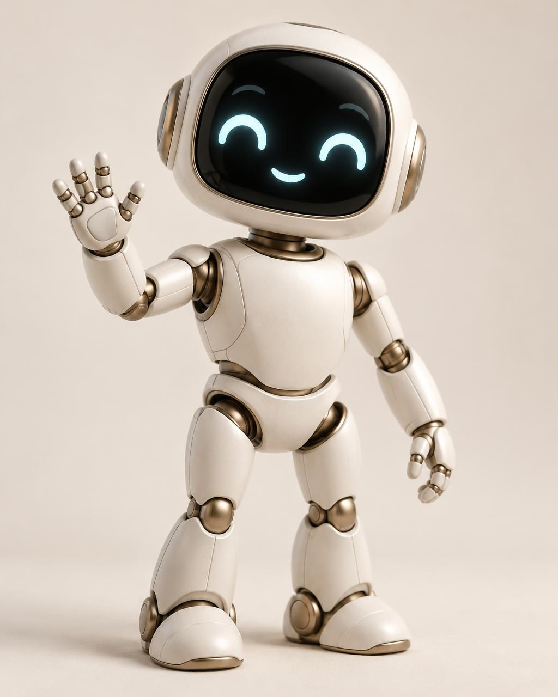
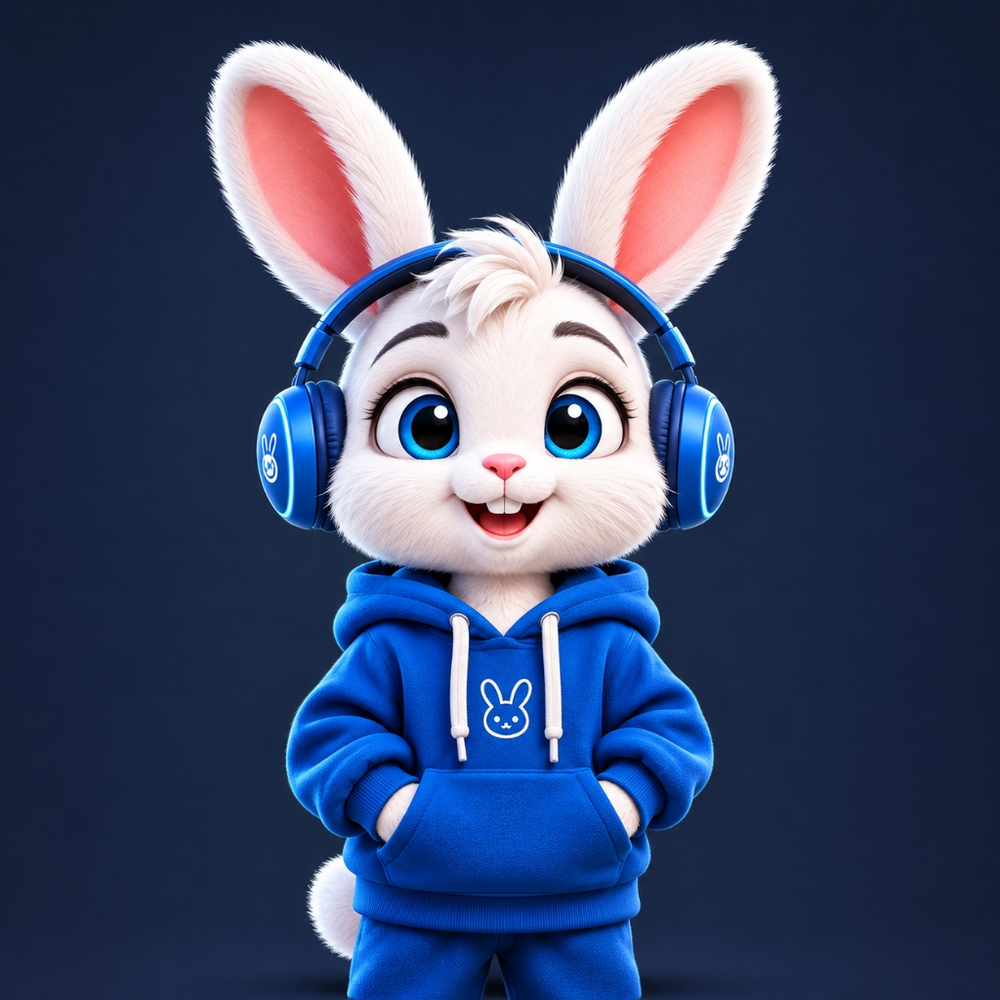

# Appu

**Open-source desktop AI companion** — a floating 3D character on your wallpaper with local reminders, memory, and optional **Google Gemini** chat (your API key).

[](https://github.com/vishnutvm/appu/actions/workflows/ci.yml)
[](https://github.com/vishnutvm/appu/actions/workflows/release.yml)
[](LICENSE)
[](package.json)

[Website](https://appu-desktop-companion.vercel.app) · [Releases](https://github.com/vishnutvm/appu/releases) · [Discussions](https://github.com/vishnutvm/appu/discussions) · [Contributing](CONTRIBUTING.md) · [Architecture](docs/ARCHITECTURE.md) · [AI & privacy](docs/AI-AND-PRIVACY.md)

---

## Screenshots

Preview assets from the [official site](https://appu-desktop-companion.vercel.app) (`appu-desktop-companion` repo).

<p align="center">
  
</p>

| Robot | Rabbit |
|:-----:|:------:|
|  |  |

---

## Why Appu

- **Desktop companion, not a web app** — Frameless overlay on macOS/Windows; right-click for menu, drag to move, ⌘K to chat.
- **Choose your character** — 3D robot, procedural rabbit (AntiGravity physics), or video-manifest companions.
- **Own your AI** — BYOK Gemini; chats and reminders stay in local SQLite (no Appu cloud).
- **Ready to ship** — electron-builder, GitHub release CI, user-approved auto-updates.

---

## Features

| Area | What you get |
|------|----------------|
| **Floating companion** | Pin, hide/summon, walk on desktop, scale & character picker in Settings |
| **Rabbit** | Hover, drag, spin, jump physics; blinks and ear twitches |
| **Video companions** | `character.json` manifests + categorized MP4 loops |
| **AI chat** | Gemini tools: reminders, memories, status; confirm before delete |
| **Updates** | Stable / Beta / Development channels; download only when you approve |

---

## Quick start

### Install (recommended)

Download **macOS** (DMG/ZIP) or **Windows** (installer) from [GitHub Releases](https://github.com/vishnutvm/appu/releases).

### Run from source

```bash
git clone https://github.com/vishnutvm/appu.git
cd appu
npm ci
cp .env.example .env   # optional GEMINI_API_KEY for local dev
npm start              # Vite (internal) + Electron companion window
```

There is **no** supported browser-only mode. Opening the dev server URL alone shows a desktop-only notice.

### AI (optional)

1. Create a key in [Google AI Studio](https://aistudio.google.com/).
2. **Preferences → AI Brain & Intelligence**, or `GEMINI_API_KEY` in `.env` for dev.
3. Keys use OS `safeStorage` when available — [AI & privacy](docs/AI-AND-PRIVACY.md).

---

## Scripts

| Command | Purpose |
|---------|---------|
| `npm start` / `npm run dev` | Desktop companion (dev) |
| `npm test` | Vitest (**195** tests) |
| `npm run build:all` | Production build + Electron |
| `npm run pack` | Unpacked app in `release/` |
| `npm run dist:mac` / `dist:win` | Installers |
| `npm run version:bump patch` | Version + tag helper |

Packaging: [Distribution & updates](docs/distribution-and-updates.md).

---

## Project structure

```
src/                   Companion UI, 3D scenes, controllers
src/rabbit-companion/  Rabbit rig + AntiGravityController
electron/              Main process, IPC, SQLite, Gemini, updater
public/characters/     Companion assets + manifests
docs/                  Architecture, privacy, releases
```

---

## Contributing

See [CONTRIBUTING.md](CONTRIBUTING.md) and [CODE_OF_CONDUCT.md](CODE_OF_CONDUCT.md). Security: [SECURITY.md](SECURITY.md).

---

## License

[MIT](LICENSE) © Appu Contributors.
